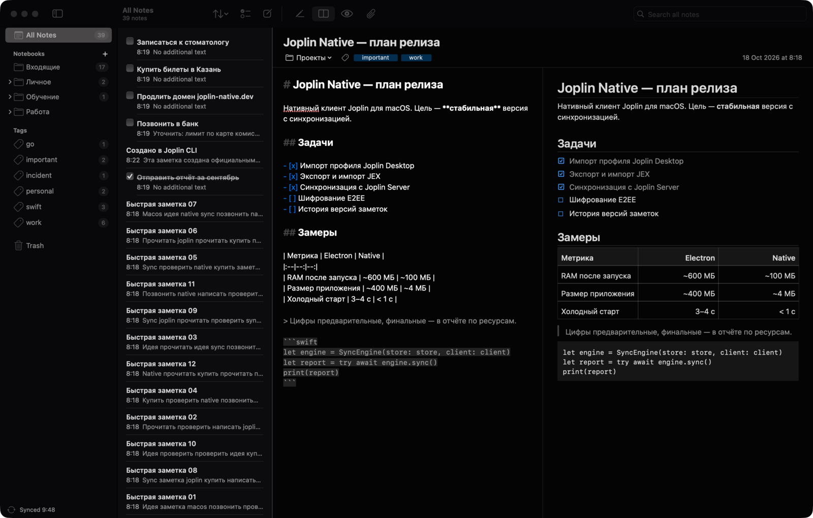

<div align="center">

# Joplin Native

**A native macOS client for [Joplin](https://joplinapp.org) notes, written in Swift.**
SwiftUI + AppKit, no Electron, no web view. Syncs with Joplin Server. Under 100 MB of RAM instead of 500 MB+.

[](https://github.com/malkafen/joplin-swift/actions/workflows/ci.yml)
[](https://github.com/malkafen/joplin-swift/releases)
[](https://github.com/laurent22/joplin/releases)


[](LICENSE)



</div>

## Why

The official Joplin desktop app is an Electron application: six processes and half a gigabyte of memory
for a small library. Joplin Native is built only from system frameworks. It uses the same data model as
Joplin, so notes keep their ids, fields and text format, and both apps can sync with the same Joplin Server.

Measured on macOS 27 (Apple M4 Pro VM, 8 GB), Joplin Desktop 3.7.21, both apps synced with the same
Joplin Server account, after a minute of idling:

| | Joplin Desktop (Electron) | Joplin Native |
|---|---|---|
| Memory footprint, 39 notes | 467 MB (6 processes) | 84 MB (1 process) |
| Memory footprint, 5000 notes | 590 MB | 94 MB |
| Resident memory (RSS), 5000 notes | 1336 MB | 198 MB |
| Threads | 122–132 | 4 |
| CPU while idle | 0.2–0.5% | 0.0% |
| Time until the window appears | 1.6 s | 0.55 s |
| First sync of 5000 notes | 105 s | 121 s |
| App size | 579 MB | 3.7 MB |
| UI | HTML/CSS in Chromium | AppKit / SwiftUI controls |

## Features

- **Notebooks**: nested notebooks with emoji icons, drag & drop, trash with restore
- **Notes and to-dos**: checkboxes in the list, completed to-dos sorted to the bottom, duplicate, move, copy link
- **Markdown editor**: `NSTextView` with syntax highlighting, native undo, spell checking and the find bar
- **Native preview**: rendered with `NSAttributedString`, `NSTextTable` and `NSTextBlock`. Clicking a
  checkbox in the preview toggles it in the source.
- **Layouts**: editor, preview, or side-by-side split (<kbd>⌃</kbd><kbd>L</kbd>)
- **Search**: full-text search over all notes with SQLite FTS5, works for any language
- **Tags**: token field with completion of existing tags
- **Attachments**: drop files or paste images. They are stored as Joplin resources and linked as `:/id`.
- **Sync with Joplin Server**: two-way, incremental (delta API), with sync locks, deletions, attachments and
  conflict copies for notes edited on two devices. Runs after edits, on an interval and with <kbd>⌘</kbd><kbd>S</kbd>.
- **Interop**: import a Joplin Desktop profile, JEX archives and RAW / file-system sync folders. Export to JEX.
- **Black theme** with deep tones (default), or follow the system appearance
- **Mac conventions**: menu bar commands and shortcuts, a Settings window, and opening `.jex` files from Finder

### Keyboard shortcuts

| Action | Shortcut | Action | Shortcut |
|---|---|---|---|
| New note | <kbd>⌘</kbd><kbd>N</kbd> | Bold / Italic | <kbd>⌘</kbd><kbd>B</kbd> / <kbd>⌘</kbd><kbd>I</kbd> |
| New to-do | <kbd>⇧</kbd><kbd>⌘</kbd><kbd>N</kbd> | Link | <kbd>⌘</kbd><kbd>K</kbd> |
| New notebook | <kbd>⌥</kbd><kbd>⌘</kbd><kbd>N</kbd> | Inline code | <kbd>⌘</kbd><kbd>E</kbd> |
| Attach file | <kbd>⇧</kbd><kbd>⌘</kbd><kbd>A</kbd> | Heading 1–3 | <kbd>⌥</kbd><kbd>⌘</kbd><kbd>1</kbd>–<kbd>3</kbd> |
| Move to trash | <kbd>⌘</kbd><kbd>⌫</kbd> | Bulleted / numbered list | <kbd>⇧</kbd><kbd>⌘</kbd><kbd>8</kbd> / <kbd>7</kbd> |
| Editor / split / preview | <kbd>⌃</kbd><kbd>⌘</kbd><kbd>1</kbd>–<kbd>3</kbd> | Checklist | <kbd>⇧</kbd><kbd>⌘</kbd><kbd>9</kbd> |
| Cycle layout | <kbd>⌃</kbd><kbd>L</kbd> | Insert date | <kbd>⇧</kbd><kbd>⌘</kbd><kbd>T</kbd> |
| Synchronise | <kbd>⌘</kbd><kbd>S</kbd> | | |

## Install

1. Download `Joplin-Native-<version>-macos-arm64.zip` from [Releases](https://github.com/malkafen/joplin-swift/releases).
2. Unzip it and move **Joplin Native.app** to `/Applications`.
3. The app is ad-hoc signed and not notarized. On first launch, right-click it and choose **Open**, or run:

   ```bash
   xattr -dr com.apple.quarantine "/Applications/Joplin Native.app"
   ```

To bring in your existing notes, use **File → Import → From Joplin Desktop Profile**. It reads
`~/.config/joplin-desktop` read-only. To sync, enter the Joplin Server URL, email and password in
**Settings → Synchronisation**. The password is kept in the app's local database, not in the Keychain:
ad-hoc signed builds would otherwise ask for Keychain access after every update.

## Status

This project is an independent client, not a port of the Electron app. What works and what does not:

| Area | Status |
|---|---|
| Notebooks, notes, to-dos, tags, trash | ✅ |
| Markdown editing and native preview | ✅ |
| Attachments (resources) | ✅ |
| Import: Desktop profile, JEX, RAW. Export: JEX | ✅ |
| Sync: Joplin Server (self-hosted), conflict copies | ✅ |
| Sync: Joplin Cloud, WebDAV, Dropbox, OneDrive, file system | 🚧 planned |
| End-to-end encryption | 🚧 planned (encrypted items are skipped; sync refuses E2EE targets) |
| Note history (revisions) | 🚧 planned |
| Rich-text (WYSIWYG) editor, plugins, Web Clipper | ❌ not planned for now |

## Versioning follows upstream Joplin

Release tags mirror the [upstream Joplin desktop releases](https://github.com/laurent22/joplin/releases)
exactly (`v3.7.21`, …). A Joplin Native release with a given tag contains the changes of the upstream release
with the same tag that apply to this client.

- **Upstream sync** ([`upstream-sync.yml`](.github/workflows/upstream-sync.yml)) runs daily. It opens a
  tracking issue labelled `upstream-sync` for each new upstream desktop release, linking its release notes and
  the upstream diff.
- The applicable changes are ported through pull requests into `main`.
- Pushing the matching tag runs [`release.yml`](.github/workflows/release.yml). The workflow refuses any tag
  that is not an upstream release, builds and tests the app, and publishes the zip with its SHA-256. The release
  is marked pre-release when upstream's is.

## Development

Requires macOS 14+ and Swift 6. Xcode is optional: the Command Line Tools are enough.

```bash
scripts/test.sh                    # unit and UI tests (Swift Testing)
scripts/coverage.sh                # tests + per-file coverage report
scripts/build-app.sh               # build/Joplin Native.app
scripts/build-app.sh --install     # also copy it to /Applications
```

```
Sources/
  JoplinCore/      data layer, no UI: SQLite, Joplin schema, item serializer, store, import/export, sync
  JoplinNative/    the app: SwiftUI scenes and views, AppKit editor, preview renderer, menu commands
Tests/
  JoplinCoreTests/     serializer compatibility, store, search, interop, sync against an in-memory Joplin Server
  JoplinNativeTests/   app model, Markdown renderer, editor, off-screen view rendering
```

- **Data**: `~/Library/Application Support/JoplinNative/` (`database.sqlite`, `resources/`).
  The tables use Joplin's column layout (`packages/lib/services/database/types.ts`).
- **Compatibility**: `Serializer` reproduces Joplin's `BaseItem.serialize` / `unserialize`, including
  property escaping and timestamp format. Tests use items captured from Joplin Desktop.
- **Command Line Tools only**: the SwiftUI macro plugin is not shipped with the CLT, so the code avoids
  `@State` / `#Preview` and keeps view state in the `@Observable` `AppModel`.

### Workflow

`main` is protected. Every change lands through a pull request that has to pass CI: build, tests and at least
90% line coverage. Each PR also produces an app bundle you can download from the CI run.

### Debug hooks

Environment variables for scripted checks, for example over SSH (no screen-recording permission needed):

| Variable | Effect |
|---|---|
| `JN_DATA_DIR=/tmp/x` | Use `/tmp/x/JoplinNative` instead of Application Support |
| `JN_SNAPSHOT=/tmp/x.png` | Render the main window to a PNG after `JN_SNAPSHOT_DELAY` seconds (default 3) |
| `JN_SNAPSHOT_QUIT=1` | Quit after the snapshot |
| `JN_SELECT_INDEX=N` | Select the N-th note in the list |
| `JN_IMPORT_DESKTOP=1` | Import the Joplin Desktop profile on launch (or pass a profile path) |

```bash
open --env JN_DATA_DIR=/tmp/demo --env JN_SNAPSHOT=/tmp/demo.png --env JN_SNAPSHOT_QUIT=1 "/Applications/Joplin Native.app"
```

## License

[AGPL-3.0-or-later](LICENSE), the same license as upstream Joplin, so code can be ported between the two projects.

Joplin Native is an independent project and is not affiliated with or endorsed by JOPLIN SAS.
Joplin® is a trademark of JOPLIN SAS.
