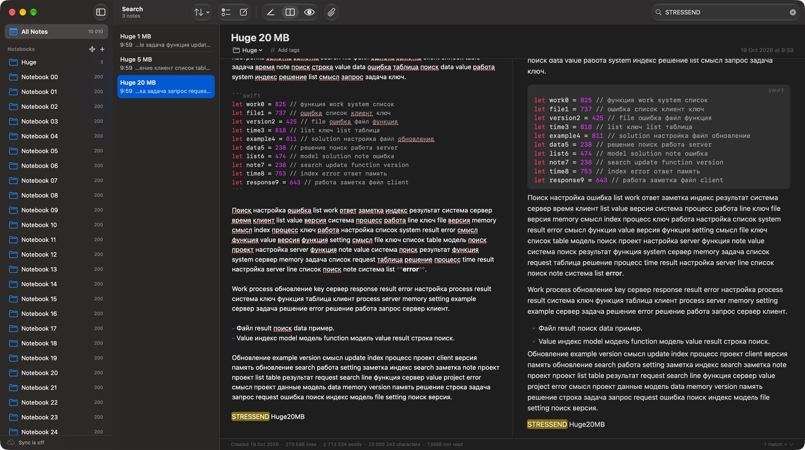
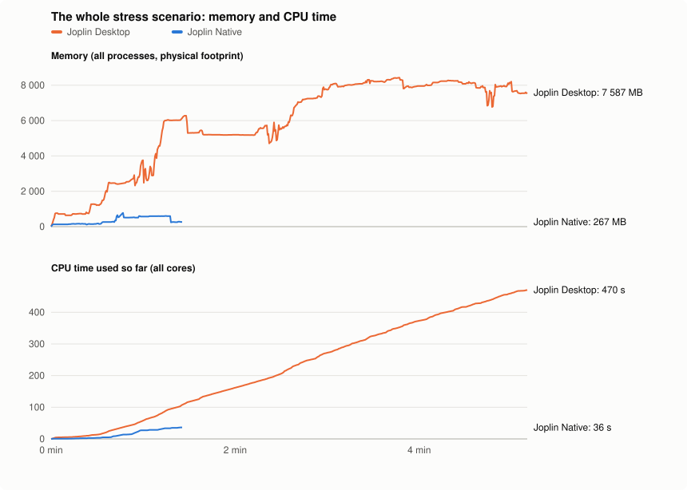

# Stress test: Joplin Native vs Joplin Desktop

Both apps get the same library and go through the same steps, driven by scripts rather than by hand. The scripts are in
[`scripts/stress`](../scripts/stress), and the raw results are in [`benchmark/`](benchmark).



## Setup

- macOS 27.0.1 in a VM on an Apple M4 Pro host, 8 cores, 8 GB of memory.
- Joplin Desktop 3.7.21 (the official Electron app, as shipped, with its default plugins), Joplin Native 3.7.21-16 and
  3.7.21-17. 3.7.21-17 renders only the changed part of the preview while you type (see below).
- One library, imported into both apps: 50 notebooks with **10 000 notes** of 0.5–6 KB (Markdown in Russian and English
  with lists, tables, code and many repeated headings), plus notes of **1 MB, 5 MB and 20 MB** (13 000, 68 000 and
  270 000 lines). [`gen.py`](../scripts/stress/gen.py) is seeded, so every run gets the same text.
- Joplin Desktop gets a profile of its own. It is driven through the Chrome DevTools Protocol like a user would drive
  it, with real mouse clicks and key events ([`jbench.py`](../scripts/stress/jbench.py)). Joplin Native runs the
  same steps from inside the app ([`StressProbe.swift`](../Sources/JoplinNative/StressProbe.swift)).
- The apps ran one after the other, never at the same time, three runs each. The two Joplin Native versions took turns
  (16, 17, 16, 17…), so they ran under the same conditions. The tables show the medians.

## What is measured

- **Time**: from the action until its result is on screen, for example until the preview shows the last line of the
  note.
- **Longest freeze**: the longest time the app could not respond, in the same window. For Joplin Desktop this is the
  longest gap between painted frames in the main window or the note viewer. For Joplin Native it is the longest
  main-thread run loop pass. Above about 1 s, macOS shows the spinning cursor.
- **CPU time and memory**: [`sample.py`](../scripts/stress/sample.py) reads the kernel's accounting of every process of
  the app four times a second: CPU time (user + system, all cores) and the physical footprint, which is what Activity
  Monitor shows as Memory. Joplin Desktop runs 7 processes, Joplin Native 1; the sums cover all of them.

A long time with a short freeze is fine: the app renders in the background and stays responsive. A long freeze is not.

## Results

| | Joplin Desktop 3.7.21 | Native 3.7.21-16 | Native 3.7.21-17 |
|:--|--:|--:|--:|
| Launch to the note list (10 000 notes) | 2.5 s | 1.0 s | 1.1 s |
| Memory after launch | 644 MB | 131 MB | 131 MB |
| Open an ordinary note (median of 20) | 53 ms | 51 ms | 51 ms |
| — longest freeze | 38 ms | 59 ms | 62 ms |
| **1 MB note** — open in the editor | 15 ms | < 5 ms | < 5 ms |
| — longest freeze | 21 ms | < 5 ms | < 5 ms |
| Open straight in split, preview shown | 46.4 s | 704 ms | 590 ms |
| — longest freeze | 21.9 s | 537 ms | 420 ms |
| Editor → split, preview shown | 797 ms | 305 ms | 285 ms |
| — longest freeze | 356 ms | 71 ms | 74 ms |
| Jump to the end (⌘↓) in split | 128 ms | 67 ms | 69 ms |
| — longest freeze | 89 ms | 71 ms | 69 ms |
| Keystroke in split (median of 5) | 78 ms | 9 ms | 6 ms |
| — slowest keystroke | 81 ms | 16 ms | 27 ms |
| Preview catches up after typing | 1.1 s | 400 ms | 286 ms |
| — longest freeze while it does | 286 ms | 64 ms | 37 ms |
| Split → preview only | 35 ms | < 5 ms | < 5 ms |
| — longest freeze | 323 ms | 74 ms | 41 ms |
| **5 MB note** — open in the editor | 251 ms | 91 ms | 84 ms |
| — longest freeze | 166 ms | 71 ms | 69 ms |
| Open straight in split, preview shown | 4.3 s | 1.3 s | 1.2 s |
| — longest freeze | 1.9 s | 78 ms | 76 ms |
| Editor → split, preview shown | 2.2 s | 1.3 s | 1.2 s |
| — longest freeze | 1.3 s | 85 ms | 76 ms |
| Jump to the end (⌘↓) in split | 8.1 s | 61 ms | 62 ms |
| — longest freeze | 8.1 s | 66 ms | 67 ms |
| Keystroke in split (median of 5) | 235 ms | 26 ms | 5 ms |
| — slowest keystroke | 267 ms | 27 ms | 59 ms |
| Preview catches up after typing | 3.5 s | 3.4 s | 325 ms |
| — longest freeze while it does | 1.7 s | 246 ms | 64 ms |
| Split → preview only | 170 ms | < 5 ms | < 5 ms |
| — longest freeze | 579 ms | 59 ms | 29 ms |
| **20 MB note** — open in the editor | 311 ms | 211 ms | 197 ms |
| — longest freeze | 417 ms | 145 ms | 134 ms |
| Open straight in split, preview shown | 15.1 s | 5.0 s | 4.7 s |
| — longest freeze | 6.2 s | 112 ms | 109 ms |
| Editor → split, preview shown | 12.2 s | 5.3 s | 4.7 s |
| — longest freeze | 6.8 s | 179 ms | 62 ms |
| Jump to the end (⌘↓) in split | 34.5 s | 89 ms | 88 ms |
| — longest freeze | 34.5 s | 92 ms | 89 ms |
| Keystroke in split (median of 5) | 1.1 s | 104 ms | 109 ms |
| — slowest keystroke | 4.3 s | 183 ms | 131 ms |
| Preview catches up after typing | 27.4 s | 20.7 s | 388 ms |
| — longest freeze while it does | 18.6 s | 983 ms | 142 ms |
| Split → preview only | 5.0 s | < 5 ms | < 5 ms |
| — longest freeze | 4.0 s | 82 ms | 44 ms |
| **Search** «значение» typed letter by letter, 5 MB note open in split: longest freeze | 719 ms | 420 ms | 428 ms |
| — results after the last key | 25 ms | < 5 ms | < 5 ms |
| Memory at the end | 8 027 MB | 499 MB | 271 MB |

“Keystroke” is the time until the frame with the typed character is painted. “Preview catches up” counts from the last
key until the preview shows the new text. Before 3.7.21-17 the drivers counted from 250 ms after the last key, so the
3.7.21-16 values of this row are about 0.25 s too low.

Joplin Desktop opened the 1 MB note in 16 s in an earlier run, and in 44–54 s in these three. It comes right after the
20 MB note, when Joplin Desktop holds about 8 GB on this 8 GB machine, so macOS is compressing and swapping its memory.

### CPU time and memory

| CPU time (all cores) / peak memory | Joplin Desktop 3.7.21 | Joplin Native 3.7.21-17 |
|:--|--:|--:|
| Launch and 10 s idle | 5.7 s / 752 MB | 855 ms / 132 MB |
| Idle 10 s after launch | 18.5 % of a core | 0.8 % of a core |
| Open 20 ordinary notes | 3.4 s / 730 MB | 1.2 s / 171 MB |
| 1 MB note, all steps (open, split, ⌘↓, type, preview, editor) | 7.5 s / 1 487 MB | 1.3 s / 180 MB |
| — typing 5 letters in split until the preview has them | 2.1 s / 1 277 MB | 401 ms / 154 MB |
| 5 MB note, all steps (open, split, ⌘↓, type, preview, editor) | 38.2 s / 3 700 MB | 4.7 s / 281 MB |
| — typing 5 letters in split until the preview has them | 11.1 s / 2 916 MB | 917 ms / 264 MB |
| 20 MB note, all steps (open, split, ⌘↓, type, preview, editor) | 246.2 s / 8 118 MB | 9.2 s / 778 MB |
| — typing 5 letters in split until the preview has them | 69.0 s / 7 263 MB | 1.1 s / 517 MB |
| Open huge notes straight in split (3) | 143.9 s / 8 444 MB | 16.4 s / 604 MB |
| Search typed letter by letter | 13.9 s / 8 589 MB | 2.7 s / 596 MB |
| **Whole scenario** | 470.5 s / 8 589 MB | 36.3 s / 778 MB |
| — wall time | 310 s | 85 s |
| — average memory | 5 834 MB | 345 MB |

Each row runs from the end of the step before to the end of the last step named, waits included, so both apps get the
same idle time. Peak memory is the highest sample in that span.



One run of each app, the one with the median length. Joplin Desktop takes longer to get through the same steps, so its
lines are longer.

## What we learned

**Where Joplin Native is far ahead.** With huge notes, Joplin Desktop freezes for seconds at a time:
- 34 s on ⌘↓ in the 20 MB note;
- 19 s while the preview re-renders after typing;
- 6–7 s on opening the note in split.

Its memory grows to 8 GB, and it uses 13 times the CPU time of Joplin Native over the whole test (471 s against 36 s).
Even idle after launch, it keeps a fifth of a core busy. Joplin Native keeps the UI responsive in all of these: the
longest freeze is under 0.5 s, and under 0.2 s for most steps.

**What 3.7.21-17 changed: the preview after typing.** Joplin Native rendered the whole note again after each pause in
typing, in the background: 3.4 s on 5 MB and 21 s on 20 MB, longer than Joplin Desktop on 5 MB (3.5 s, with a 1.7 s
freeze). Now it renders only the changed blocks, with one block on each side to check that the change went no further
(an unclosed code fence does), and swaps them into the shown text. On the 5 MB note that takes 3–5 ms off the main thread and
4–7 ms on it, against 3.4 s for the whole note. The preview catches up in 0.3–0.4 s, most of which is the pause it waits for
between updates while you type. CPU time for typing five letters in the 20 MB note fell to 1.1 s, against 69 s for
Joplin Desktop.

A test makes thousands of random edits and checks that the result is exactly a full render: text, fonts, spacing,
anchors and checkbox lines. What links distant parts of a note still makes it render whole: `[toc]`, reference-style
link definitions, `$$` formulas, an unclosed inline HTML tag, or a change to the set of headings that would renumber
equal headings below. Large changes, such as pasting more than 200 000 characters, also render whole.

Along the way the test found two older bugs: a formula inside a code block that Markdown and the formula finder see
differently showed up as a number, and so did a formula in a heading's link anchor. Both are fixed. Checking a huge
note for `$` also became faster, which shortened the first preview of the 20 MB note from 5.0 to 4.7 s.

**Where Joplin Native is still slower.** These are small, and none freezes the UI:
- Opening an ordinary note freezes for up to 62 ms against 38 ms. Both are below what anyone notices.
- The slowest of the five keystrokes on the 5 MB note took 59 ms (the median is 5 ms against Joplin Desktop's 235 ms).
- On 20 MB, the first preview takes 4.7 s. It renders in the background without freezing the UI. Joplin Desktop takes
  12–15 s and freezes for 6–7 s.

**Earlier fixes from this test (3.7.21-16).** Search typed letter by letter froze for 49 s (the snippet query expanded
the prefix for every row), ⌘↓ in a huge note in split froze for up to 10.7 s, and opening a 1 MB note after the 20 MB one
froze for 8.7 s. All three are under 0.5 s now.

## Run it yourself

On a Mac with `/Applications/Joplin.app` installed:

```bash
scripts/build-app.sh
scripts/stress/run.sh          # RUNS=3 by default; data and results go to /tmp/stress
scripts/stress/chart.py usage.svg "Joplin Desktop=/tmp/stress/res-joplin-*.json" "Joplin Native=/tmp/stress/res-native-*.json"
```

It takes about 10 minutes per Joplin Desktop run and 1.5 minutes per Joplin Native run. Your own Joplin profile is not
touched.
